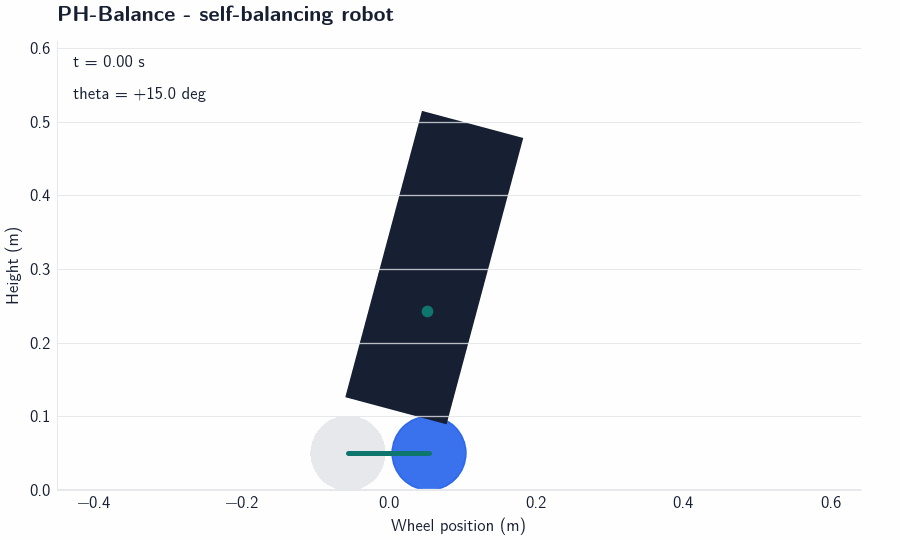
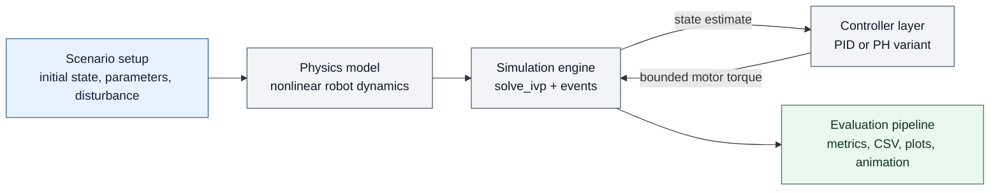
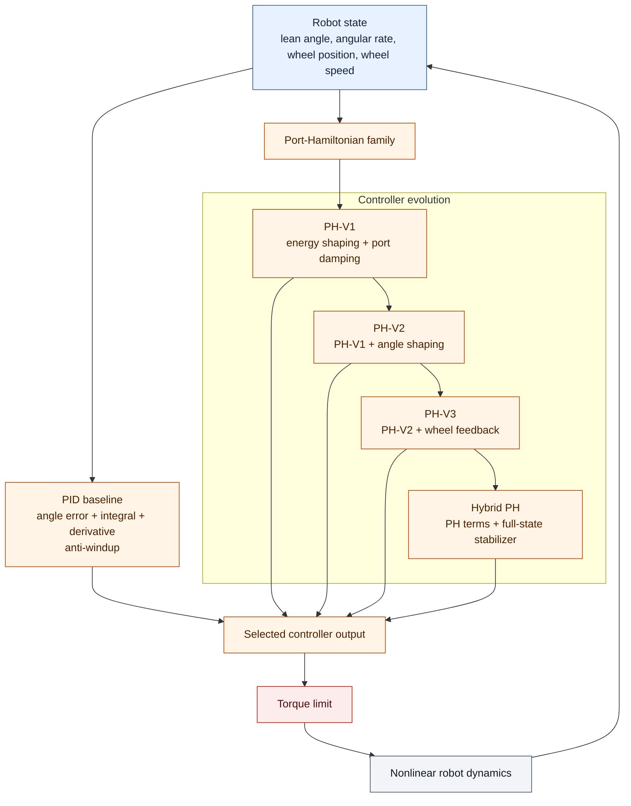

# PH-Balance

### Port-Hamiltonian Control for a Self-Balancing Robot

[](https://github.com/aimldlnlp/ph-balance/actions/workflows/ci.yml)
[](https://github.com/aimldlnlp/ph-balance/releases)

**v1.0.0 — simulation portfolio release**

PH-Balance is a robotics control engineering project built around one
practical question:

> Can an energy-based controller keep an unstable two-wheel robot balanced
> while limiting wheel drift and rejecting disturbances?

The project combines a nonlinear robot model, multiple controller designs, a
reproducible simulation pipeline, and measured comparisons against a PID
baseline.



[Open the 30-second demo showcase](results/showcase/README.md)

## At a glance

| Signal | Result |
| --- | --- |
| Full comparison | PID, PH-V1, PH-V2, PH-V3, Hybrid PH |
| Official test matrix | 12 scenarios per controller |
| Overall success | PID 12/12; Hybrid PH 10/12; PH-V3 3/12 |
| Main-case wheel drift | Hybrid PH 0.053 m vs PID 0.631 m successful-run mean |
| Validation | 67 unit tests; deterministic CSV, plots, and trajectory exports |

The headline is a trade-off: PID is the most reliable controller in this
simulation matrix, while Hybrid PH improves wheel regulation and the earlier
Port-Hamiltonian variants. This release is simulation-only, not a hardware
validation result.

## What was built

This is an end-to-end control stack for a planar two-wheel self-balancing
robot:

- nonlinear equations of motion for the inverted-pendulum system;
- kinetic, potential, physical, and control-shaped Hamiltonians;
- PID and four generations of Port-Hamiltonian-inspired controllers;
- a `scipy.integrate.solve_ivp` simulation framework with disturbances and
  termination events;
- reproducible angle, disturbance, and parameter-uncertainty experiments;
- trajectory exports, engineering metrics, comparison plots, and animation;
- unit tests for the model, controllers, simulator, metrics, and experiment
  pipeline.

The goal is not to claim a hardware-ready controller. The goal is to show the
engineering process required to turn a nonlinear control idea into a testable
software system.

## Engineering challenge

An inverted pendulum is unstable by default. The controller must react to
lean angle and angular velocity while moving the wheels in the correct
direction. A controller that reduces angle error can still allow the robot to
drift indefinitely.

That creates two coupled requirements:

1. stabilize the body around the upright position;
2. regulate the wheel mode without sacrificing disturbance rejection.

The project uses the same nonlinear plant, timestep, torque limit, and success
criteria for each controller so the comparison measures controller behavior
rather than different simulation conditions.

## System architecture



The simulator closes the control loop: it sends the current robot state to one
controller, applies the returned torque to the nonlinear plant, and passes the
trajectory to the evaluation pipeline.

The code keeps physics, control, simulation, experiments, and visualization
separate:

```text
src/
├── models/          robot dynamics, parameters, state, Hamiltonian
├── controllers/     PID and Port-Hamiltonian controller variants
├── simulation/      integration, disturbances, result export
├── visualization/   plots, animation, and visual style
└── utils/

experiments/         scenario definitions, metrics, and runners
tests/               regression and validation tests
results/             trajectories, plots, summaries, and reports
```

## Controller architecture



The controller comparison is intentionally layered: PID is the practical
baseline, the PH variants show the design iterations, and Hybrid PH combines
the energy-based terms with local state feedback for wheel-mode regulation.

## Controller evolution

The controller sequence is an iterative engineering story, not a collection
of unrelated algorithms.

| Version | Design | What it taught us |
| --- | --- | --- |
| PID | Angle error, integral action, derivative damping, anti-windup | A strong practical baseline for fast stabilization. |
| PH-V1 | Scalar energy shaping and actuator-port damping | Total energy alone does not select the correct lean direction. |
| PH-V2 | Adds directional angle shaping | Angle direction improves, but the wheel mode is still under-regulated. |
| PH-V3 | Adds angle, wheel-position, and wheel-velocity feedback | Recovers local nominal stabilization, but remains sensitive to disturbances and uncertainty. |
| Hybrid PH | Keeps PH energy/port-damping terms and adds full-state local feedback | Improves the tested robustness and wheel regulation while keeping the energy-based structure visible. |

Hybrid PH is intentionally described as a hybrid, PH-inspired controller. It
retains energy shaping and damping injection, but its full-state stabilizer is
designed locally rather than presented as a complete global IDA-PBC proof.

## Measured results

Phase 3 uses 12 deterministic scenarios per controller:

- 15 degree stabilization;
- a 1 N m body-torque disturbance;
- +25% body mass and 2x friction;
- initial angles of 5, 15, 30, and 45 degrees;
- disturbance pulses from 0.2 to 2.0 N m.

### Success rate

| Controller | Main cases | Angle sweep | Disturbance sweep | All cases |
| --- | ---: | ---: | ---: | ---: |
| PID | 3/3 | 4/4 | 5/5 | **12/12** |
| PH-V1 | 0/3 | 0/4 | 0/5 | 0/12 |
| PH-V2 | 0/3 | 0/4 | 0/5 | 0/12 |
| PH-V3 | 1/3 | 1/4 | 1/5 | 3/12 |
| Hybrid PH | 3/3 | 2/4 | 5/5 | **10/12** |

The two unsuccessful Hybrid PH angle cases did not hit the 85 degree
termination limit, but they did not settle within the 4 second experiment
horizon. That distinction matters: avoiding fallover is not the same as
achieving the requested regulation objective.

### Main-case trade-offs

| Scenario | Controller | Angle RMSE (deg) | Settling (s) | Final wheel drift (m) | Torque effort (N m s) |
| --- | --- | ---: | ---: | ---: | ---: |
| 15 degree stabilization | PID | 2.250 | 0.220 | 0.453 | 0.402 |
| 15 degree stabilization | Hybrid PH | 3.164 | 1.680 | 0.021 | 0.297 |
| 1.0 N m disturbance | PID | 0.177 | 0.000 | 0.916 | 0.185 |
| 1.0 N m disturbance | Hybrid PH | 2.079 | 6.980 | 0.122 | 0.401 |
| Parameter uncertainty | PID | 2.260 | 0.220 | 0.522 | 0.396 |
| Parameter uncertainty | Hybrid PH | 3.235 | 1.640 | 0.015 | 0.327 |

The measured trade-off is clear:

- PID is faster, has lower angle error, and achieves the highest overall
  success rate.
- Hybrid PH produces much less final wheel drift in the three main cases and
  completes more robustness tests than the earlier PH versions.
- Hybrid PH does not dominate PID on every metric and should not be presented
  as the universal winner.

More plots and the complete per-run data are available in the
[Phase 3 final report](results/phase3/final_report.md), including angle
sweeps, disturbance sweeps, energy deviation, wheel drift, and control
effort. The compact [results dashboard](results/phase3/dashboard.md) is
intended as the fastest reviewer overview.

## Engineering decisions

### Fair comparisons

All controllers use the same nonlinear plant, 0.02 second integration hold,
3 N m torque limit, 85 degree fallover threshold, and persistent 2 degree
settling band.

### Metrics that expose failure

Terminated simulations are not treated as efficient just because they have a
shorter trajectory. The pipeline records success, termination reason,
fallover count, settling time, RMSE, wheel drift, and zero-order-hold torque
effort separately.

### Reproducible evidence

Each scenario stores its configuration, controller trajectories, metrics, and
comparison plot. The official Phase 3 matrix is generated from one command so
results can be regenerated after a model or controller change.

## Technical notes

- [Nonlinear system model](phase-1/SYSTEM_MODEL.md)
- [Port-Hamiltonian formulation](phase-1/PORT_HAMILTONIAN_CONTROL.md)
- [Phase 3 final analysis](results/phase3/final_report.md)
- [Results dashboard](results/phase3/dashboard.md)
- [Demo showcase](results/showcase/README.md)

## Run the project

```bash
python -m venv .venv
```

Activate the environment, then install the CPU-only dependencies:

```bash
pip install -r requirements.txt
```

Run the test suite:

```bash
python -m unittest discover -s tests
```

Run the full five-controller Phase 3 comparison:

```bash
python -m experiments.run_phase3_experiments
```

Build the portfolio dashboard from the generated CSV results:

```bash
python -m experiments.build_phase3_dashboard
```

Regenerate the nominal balancing and disturbance-recovery animations:

```bash
python -m experiments.build_demo_assets
```

Generated data is written under `results/phase3/`:

- `metrics.csv` — one row per controller/scenario result;
- `robustness_summary.csv` — grouped success and successful-run metrics;
- `main/`, `angle_sweep/`, and `disturbance_sweep/` — trajectories and plots;
- `dashboard.md` and `dashboard/` — portfolio overview plots and summary;
- `final_report.md` — detailed analysis and limitations.

## Limitations

This is a simulation portfolio project, not a hardware validation result.
Current experiments assume direct state feedback, ideal sensing, no actuator
delay, no motor electrical dynamics, no wheel slip, and deterministic single
trials. Only one mass/friction perturbation is tested. Negative initial lean,
randomized disturbances, sensor noise, and repeated statistical trials are
future validation steps.

The current Hybrid PH controller is locally designed and does not have a
formal global stability proof for the nonlinear saturated closed loop.

## Future work

- add sensor noise, sample delay, motor dynamics, and randomized trials;
- expand parameter and disturbance sweeps;
- add maximum wheel excursion and total wheel travel metrics;
- investigate gain scheduling or a formally derived energy-shaping
  stabilizer;
- validate the controller in hardware or hardware-in-the-loop;
- add randomized, noisy, and delayed closed-loop validation.

## Portfolio takeaway

PH-Balance demonstrates a complete robotics control workflow: model the plant,
implement competing controllers, test them under shared conditions, inspect
failures, and report trade-offs without forcing a positive conclusion.

The result is a research-inspired engineering prototype with a clear next
step toward hardware validation.

## License

Released under the [MIT License](LICENSE).
