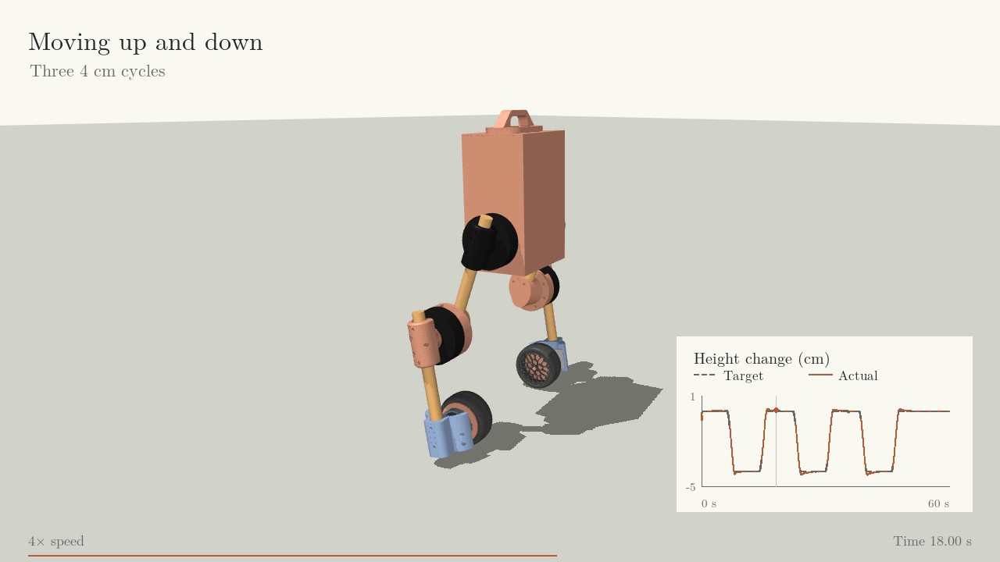

# PH-Balance

**3D balance and active height control for Upkie**

I built a MuJoCo simulation that keeps Upkie upright while it turns, responds
to disturbances, and moves its body up and down. The controller combines
Port-Hamiltonian energy shaping with a local LQR stabilizer and bounded
integral correction. It runs on CPU and uses delayed IMU and encoder observations.

[](https://aimldlnlp.github.io/ph-balance/)

[Watch the 74-second demo](https://aimldlnlp.github.io/ph-balance/)

The video shows recovery, steering, three 4 cm height cycles, an energy
visualization, and the one test that missed the settling requirement.

## What I built

The robot has a free-floating base with roll and yaw left unconstrained.
Both wheels control balance and heading; the hips and knees move the torso.
Ground collisions and the source model's torque, speed, and position limits
stay enabled. A foot, bracket, or body touching the ground counts as a failure.

The controller receives timestamped sensor packets through a causal state
estimator. Ground truth is used for sensor emulation and evaluation, never
as a shortcut into the balancing law. The nominal mass matrix, energy model,
and local stabilizer change with the commanded leg posture.

The difficult part was keeping this working when sensing and actuation stopped
being ideal. The final study combines sensor bias and drift, variable delay,
packet loss, motor lag, uncertain torso mass, and persistent disturbances.
An earlier version passed 189 of 200 cases. I kept that result, selected one
damping change using development cases, and tested it on 200 new cases.

## Results

The final controller passes **199 of 200 new 60-second tests**. The 95% Wilson
confidence interval is **97.22% to 99.91%**. Every case completes the full minute
without body/bracket ground contact or physical-limit termination. The remaining failure does
not confirm five seconds of settling before the next disturbance. It stays
in the denominator.

| Worst value across all 200 cases | Measured |
|---|---:|
| Distance from the starting position | 0.161 m |
| Final position error | 0.028 m |
| Lean error after transients | 1.714 degrees |
| Height error after settling | 2.94 mm |

The final study varies torso mass and inertia by 20% in either direction,
friction from 0.4 to 0.8, and attitude noise from 0.2 to 0.5 degrees RMS.
Observation delay is 10 to 25 ms with 5 ms jitter and 10% packet loss. Motor
lag ranges from 5 to 20 ms. Tests also include initial lean up to 10 degrees,
15-degree turns, sideways pushes, and persistent pitch torque.

### What did the PH terms add?

In the first matched stress study, PH with integral correction passed
**189/200**, versus **121/200** for the same controller with the PH terms
removed. On the 121 pairs where both passed, PH reduced absolute wheel-torque
effort by **14.60%** and positive mechanical work by **10.94%**. Those cost
comparisons apply only to the common successful pairs. They are not battery
energy measurements or a comparison against every independently tuned LQI design.

The 199/200 follow-up has new cases and no paired comparator. In the earlier,
less demanding study, both PH and LQR passed 200/200 and the wheel-effort
improvement was only **1.013%**. The original 10% hypothesis was not supported
there. These results describe different test conditions, not interchangeable scores.

[Evaluation details and limitations](docs/evaluation.md)

## Run the simulation

Python 3.12 is used in CI. From a fresh clone:

```bash
python -m venv .venv
# Activate the environment for your shell
python -m pip install -r requirements.txt
python -m unittest discover -s tests -v
```

Repeat the final 200-case study with its saved cases and controller settings:

```bash
python -m experiments.refine_upkie_ph --protocol evaluation/stress/protocol.json --output results/repeat --workers 4
python -m experiments.analyze_results --evaluation results/repeat --output results/repeat-summary.json
```

The 69 automated tests cover model dynamics, causal observations, controller
behavior, actuator limits, and evaluation checks.

Use a new output directory. The runner checks source hashes and saves native
states, observations, applied torques, and per-case metrics. Generated runs
are ignored by Git. No GPU or learned policy is needed.

## Inside the project

- `src/simulation`: robot model, local multibody design, and state estimation
- `src/controllers` and `src/models`: energy and dynamics utilities
- `experiments`: simulation runners, evaluation checks, and statistical analysis
- `tests`: physics, controller, causal sensing, actuator, and evaluation tests
- `evaluation`: fixed protocols and compact metrics for all reported studies

[Control and energy model](docs/control.md)

This is simulation work. The IMU supplies modeled fused attitude and a heading
reference; raw accelerometer fusion and magnetic disturbances are not validated.
Motor and sensor errors are assumptions, not hardware calibration. The hybrid
controller has no global stability or passivity proof.

## Credits

The robot design and assets come from the [Upkie project](https://github.com/upkie/upkie_description).
The tire was created by bramesh501 and adapted by Upkie. Source assets retain
their Apache-2.0 and CC BY 4.0 licenses. My contributions are the simulation
adaptation, control, state estimation, evaluation, and presentation.

[Full attribution](third_party/upkie/ATTRIBUTION.md)
