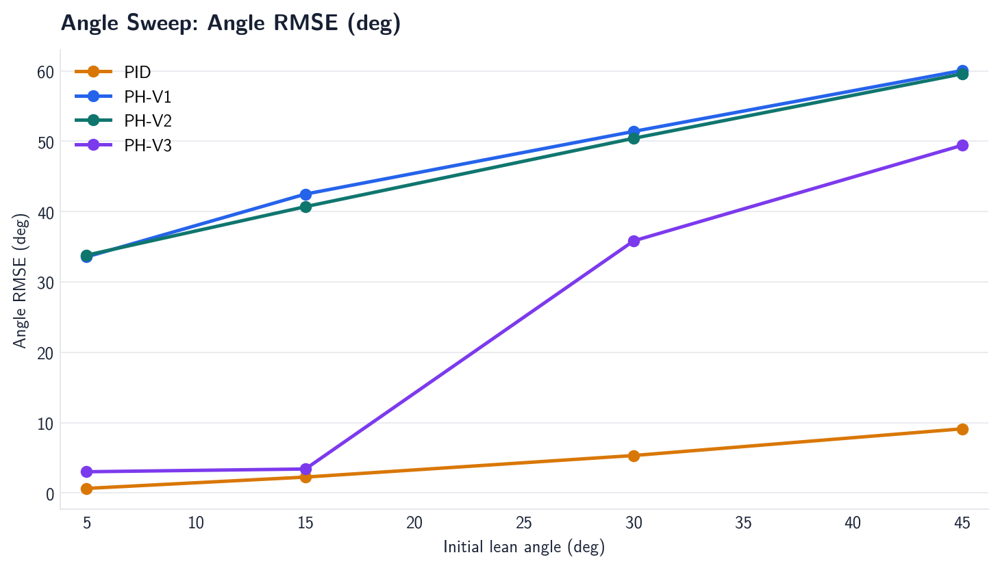
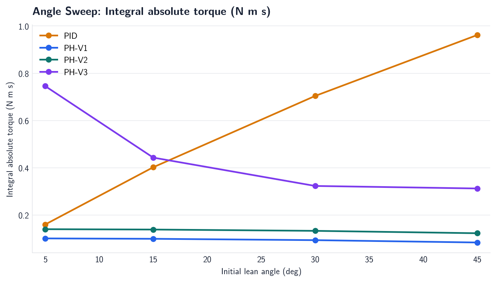
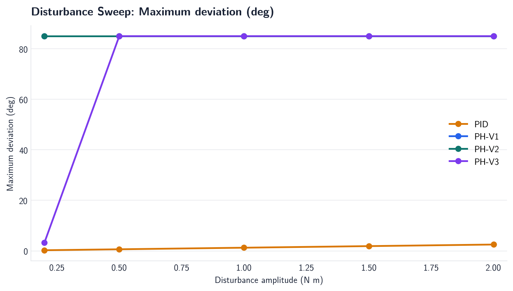
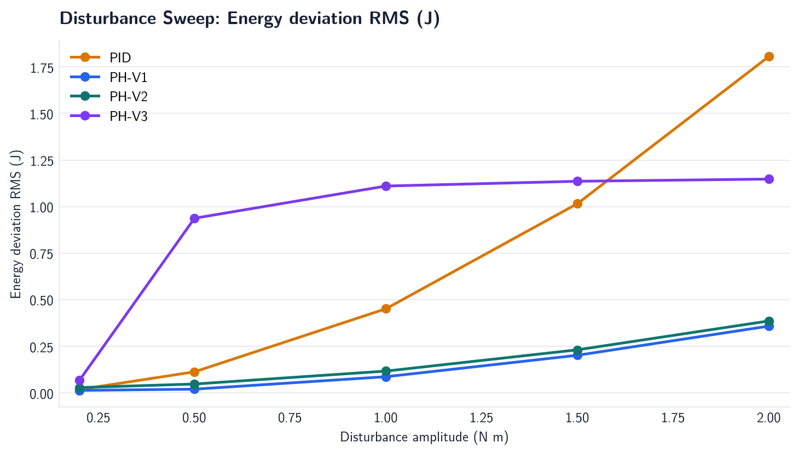
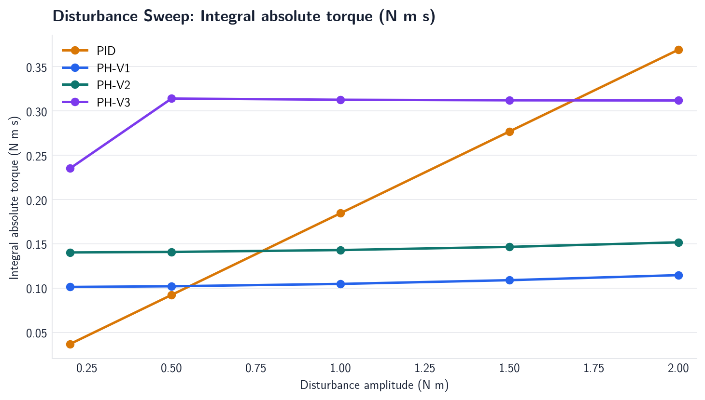

# PH-Balance Phase 2C Final Comparison

## Executive conclusion

PH-V3 solves the principal **local** failure observed in PH-V2: it can
stabilize the nominal 15 degree lean, whereas PH-V1 and PH-V2 fall over. It
does not solve the broader robustness problem. With the fixed reference gains
used by the official comparison, the success rates are:

| Controller | Main scenarios | Angle sweep | Disturbance sweep | All 12 scenarios |
| --- | ---: | ---: | ---: | ---: |
| PID | 3/3 | 4/4 | 5/5 | **12/12** |
| PH-V1 | 0/3 | 0/4 | 0/5 | **0/12** |
| PH-V2 | 0/3 | 0/4 | 0/5 | **0/12** |
| PH-V3 | 1/3 | 1/4 | 1/5 | **3/12** |

Therefore, PH-V3 is a meaningful research improvement over PH-V2, but it is
not a demonstrated replacement for PID and should not be described as the
best-performing controller in this experiment set.

## Comparison basis

The official comparison uses the same plant model, timestep, torque limit,
initial conditions, disturbance definitions, and termination threshold for all
controllers. A run is successful only when it reaches the tolerance band and
does not terminate early. Torque effort uses the simulator's zero-order hold.
Runs that hit the 85 degree angle limit are marked with `success=0`, a
termination time, and a fallover penalty. Their shorter effort values are
diagnostic; they must not be interpreted as efficiency.

The official PH-V3 reference gains are `Ke=0.1`, `Ktheta=4.0`, `Ks=0.1`, and
`Kv=0.01`. The separate systematic search selected
`Ke=0.2`, `Ktheta=8.0`, `Ks=1.0`, and `Kv=0.01`; that candidate passed 2/3 main
scenarios but still failed the 1.0 N m disturbance case. The angle and
disturbance sweeps were not rerun with that selected candidate, so the sweep
results below are for the official reference gains.

## Main experiment results

| Scenario | Controller | Success | RMSE (deg) | Settling (s) | Recovery (s) | ZOH effort (N m s) | Termination |
| --- | --- | ---: | ---: | ---: | ---: | ---: | --- |
| 15 deg stabilization | PID | 1 | 2.250 | 0.220 | -- | 0.402 | -- |
| 15 deg stabilization | PH-V1 | 0 | 42.493 | -- | -- | 0.099 | 0.741 s, angle limit |
| 15 deg stabilization | PH-V2 | 0 | 40.705 | -- | -- | 0.139 | 0.793 s, angle limit |
| 15 deg stabilization | PH-V3 | 1 | 3.399 | 1.420 | -- | 0.443 | -- |
| 1.0 N m disturbance | PID | 1 | 0.177 | 0.000 | 0.000 | 0.185 | -- |
| 1.0 N m disturbance | PH-V1 | 0 | 14.517 | -- | -- | 0.105 | 5.762 s, angle limit |
| 1.0 N m disturbance | PH-V2 | 0 | 14.269 | -- | -- | 0.143 | 5.794 s, angle limit |
| 1.0 N m disturbance | PH-V3 | 0 | 15.276 | -- | -- | 0.313 | 6.105 s, angle limit |
| Parameter uncertainty | PID | 1 | 2.260 | 0.220 | -- | 0.396 | -- |
| Parameter uncertainty | PH-V1 | 0 | 41.759 | -- | -- | 0.111 | 0.691 s, angle limit |
| Parameter uncertainty | PH-V2 | 0 | 40.601 | -- | -- | 0.151 | 0.736 s, angle limit |
| Parameter uncertainty | PH-V3 | 0 | 20.768 | -- | -- | 0.490 | 2.896 s, angle limit |

### Interpretation

- PH-V3 changes the nominal result qualitatively: it completes the 4 s run
  and settles from 15 degrees. PH-V1 and PH-V2 fall within the first second.
- The improvement is not free: PH-V3 settles about 1.2 s slower than PID and
  has slightly higher nominal effort, 0.443 versus 0.402 N m s.
- PH-V3 has lower nominal peak torque, 1.035 N m versus PID's 3.000 N m
  limit. This is a real peak-actuation advantage in the nominal run, but it
  does not translate into disturbance robustness.
- Under the 1.0 N m disturbance, PID recovers immediately in the sampled
  metric and completes the run. PH-V3 reaches the angle limit at 6.105 s.
- Under the mass/friction change, PH-V3 also falls over. This rules out a
  robustness claim for the current gain set.

## Sweep evidence

### Initial-angle sweep

| Initial angle | PID | PH-V1 | PH-V2 | PH-V3 |
| ---: | ---: | ---: | ---: | ---: |
| 5 deg | pass | fallover | fallover | incomplete, no settling |
| 15 deg | pass | fallover | fallover | pass |
| 30 deg | pass | fallover | fallover | fallover |
| 45 deg | pass | fallover | fallover | fallover |

The largest tested initial angle with a successful run is 45 degrees for PID
and 15 degrees for PH-V3. PH-V3's 5 degree run did not hit the angle limit,
but it still failed the success definition because the final trajectory did
not remain within the 2 degree tolerance band.

### Disturbance-amplitude sweep

| Pulse amplitude | PID | PH-V1 | PH-V2 | PH-V3 |
| ---: | ---: | ---: | ---: | ---: |
| 0.2 N m | pass | fallover | fallover | pass |
| 0.5 N m | pass | fallover | fallover | fallover |
| 1.0 N m | pass | fallover | fallover | fallover |
| 1.5 N m | pass | fallover | fallover | fallover |
| 2.0 N m | pass | fallover | fallover | fallover |

PH-V3 therefore demonstrates a narrow disturbance envelope: it succeeds at
0.2 N m but not at 0.5 N m or above. PID completes every tested pulse. The
flat 85 degree curves for PH-V1, PH-V2, and failed PH-V3 runs are fallover
clipping, not evidence of equivalent physical deviation.

## Controller evolution

| Version | Added structure | Result |
| --- | --- | --- |
| PH-V1 | Scalar energy shaping and actuator-port damping | Energy-only law does not select the correct lean direction; 0/12 successes. |
| PH-V2 | Directional angle shaping | Corrects the local angle direction, but the wheel mode remains insufficiently regulated; 0/12 successes. |
| PH-V3 | Angle shaping plus wheel-position and wheel-velocity feedback | Local nominal stabilization is recovered; robustness remains limited; 3/12 successes. |

The data support the claim that PH-V3 addresses the dominant PH-V2 failure
mode. They do not support a claim of global asymptotic stability or broad
robustness.

## Practical advantages

The current evidence supports these narrower advantages:

1. PH-V3 has an interpretable energy/angle/translation structure rather than
   only a manually shaped error signal.
2. It stabilizes the nominal 15 degree condition with a lower peak torque than
   PID in this model.
3. It avoids an integral state, so integral windup is not part of this
   controller's failure modes.
4. The gain search gives a reproducible tuning procedure and found a candidate
   that passed 2/3 main scenarios, although it still failed disturbance
   rejection.

These are architectural or nominal advantages, not evidence that PH-V3 is
more reliable or more efficient than PID.

## Remaining limitations

- **Small region of attraction.** The angle sweep fails at 30 and 45 degrees,
  and even the 5 degree run does not meet the strict settling criterion.
- **Poor disturbance margin.** The reference controller fails at 0.5 N m and
  above; the tuned candidate has not been shown to improve this envelope.
- **Parameter sensitivity.** A 25% body-mass increase and doubled friction
  cause PH-V3 to fall over while PID remains stable.
- **Local rather than complete PH proof.** The controller combines a physical
  plant Hamiltonian with practical angle and wheel feedback. It is a local
  engineering law, not a complete IDA-PBC or global Lyapunov construction.
- **Limited uncertainty study.** Only one mass/friction perturbation was
  tested. Inertia, wheel radius, gravity, actuator constants, delay, and
  friction nonlinearities were not swept.
- **Ideal sensing and actuation.** The simulation assumes direct state
  feedback, no sensor noise, no delay, no sampling jitter, no motor dynamics,
  no wheel slip, and no battery/voltage limits.
- **One-sided deterministic tests.** Initial lean tests use positive angles,
  and each condition is run once. Negative lean, repeated noisy trials, and
  randomized disturbances are absent.
- **Metric caveat.** A terminated run has a shorter trajectory. The corrected
  success flag and fallover penalty prevent its low effort from being read as
  an advantage, but raw RMSE and effort from failed runs are still not
  directly comparable to completed runs.

## Final verdict

PH-V3 is a successful **local redesign** and a valid research step beyond
PH-V2. It is not the winning controller in this data set. PID is the more
reliable practical baseline: it succeeds in every tested scenario, handles
the full angle sweep, and rejects the full disturbance sweep. The defensible
portfolio claim is therefore:

> PH-V3 demonstrates that adding directional angle shaping and wheel-mode
> regulation repairs the nominal energy-only failure, but the resulting
> controller remains locally tuned and substantially less robust than PID.

Source data: [metrics.csv](metrics.csv),
[angle_sweep_metrics.csv](angle_sweep_metrics.csv),
[disturbance_sweep_metrics.csv](disturbance_sweep_metrics.csv), and the
[PH-V3 tuning report](../tuning/phase2c_ph_v3_summary.md).
