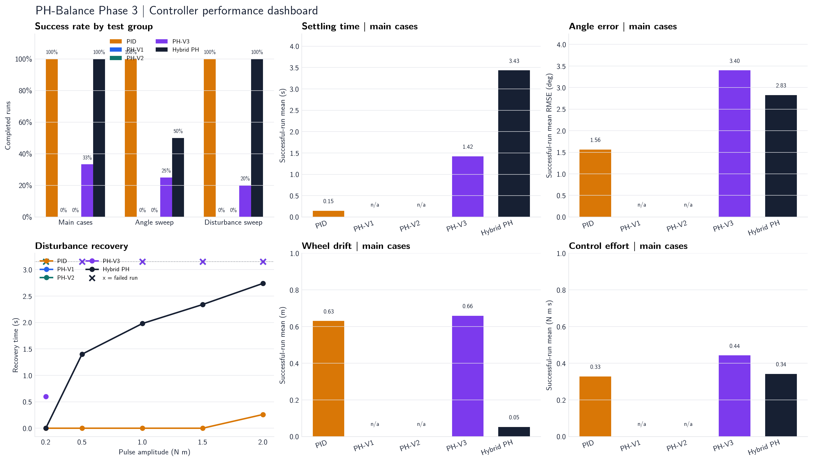
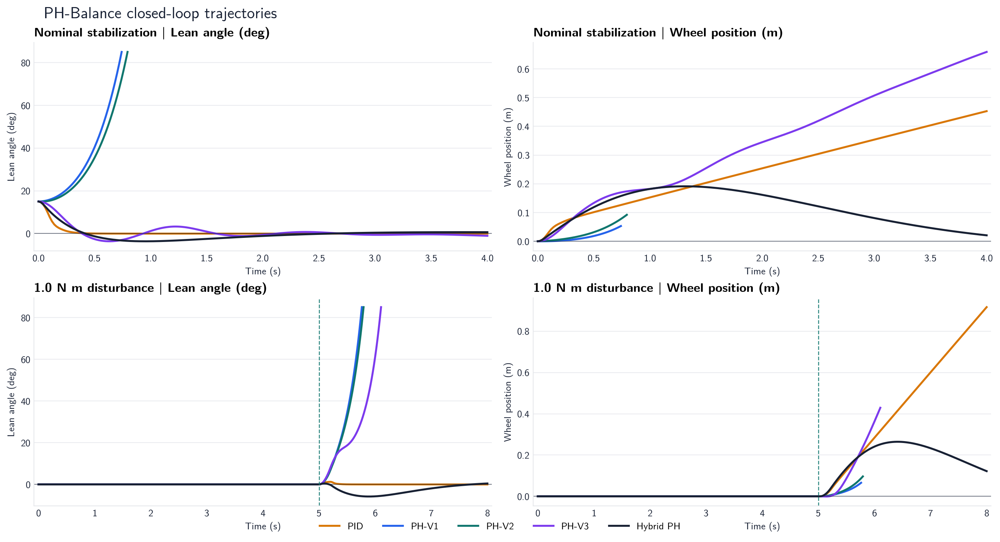

# PH-Balance Phase 3 Results Dashboard

A portfolio view of the five-controller comparison. The dashboard prioritizes success, angle regulation, disturbance recovery, wheel drift, and control effort.

## How to read this dashboard

- Success rate includes every configured run, including failed runs.
- Continuous metric bars use successful-run means for the three main cases only.
- In the recovery plot, `x` marks a run that did not produce a valid recovery time because it terminated or failed the success criteria.
- Trajectories that stop early are visible; their shorter duration is not treated as lower effort or better performance.

## Success-rate summary

| Controller | Main | Angle sweep | Disturbance sweep | All 12 cases |
| --- | ---: | ---: | ---: | ---: |
| PID | 3/3 | 4/4 | 5/5 | 12/12 |
| PH-V1 | 0/3 | 0/4 | 0/5 | 0/12 |
| PH-V2 | 0/3 | 0/4 | 0/5 | 0/12 |
| PH-V3 | 1/3 | 1/4 | 1/5 | 3/12 |
| Hybrid PH | 3/3 | 2/4 | 5/5 | 10/12 |

## Main-case performance

Successful-run means; terminated runs are shown as `-`.

| Controller | Angle RMSE (deg) | Settling (s) | Wheel drift (m) | Effort (N m s) |
| --- | ---: | ---: | ---: | ---: |
| PID | 1.562 | 0.147 | 0.631 | 0.328 |
| PH-V1 | - | - | - | - |
| PH-V2 | - | - | - | - |
| PH-V3 | 3.399 | 1.420 | 0.659 | 0.443 |
| Hybrid PH | 2.826 | 3.433 | 0.053 | 0.342 |

## Practical reading

- PID is the most reliable controller in this matrix: 12/12 successful runs, with faster angle settling and lower angle error.
- Hybrid PH improves substantially over PH-V1, PH-V2, and PH-V3 and achieves lower final wheel drift in the main cases.
- Hybrid PH completes all tested disturbance amplitudes, but its recovery time, angle error, and effort increase as pulse amplitude increases.
- PH-V1 and PH-V2 fall over in every official Phase 3 scenario; their short trajectories must not be interpreted as low effort.

## Source data

- [All controller metrics](metrics.csv)
- [Grouped robustness summary](robustness_summary.csv)
- [Detailed Phase 3 analysis](final_report.md)

Generated by `python -m experiments.build_phase3_dashboard`.
