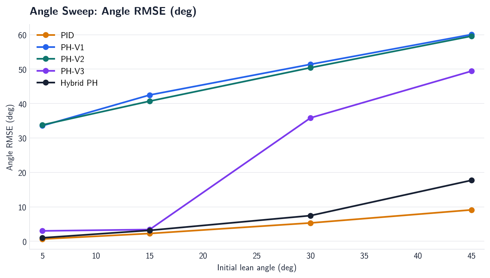
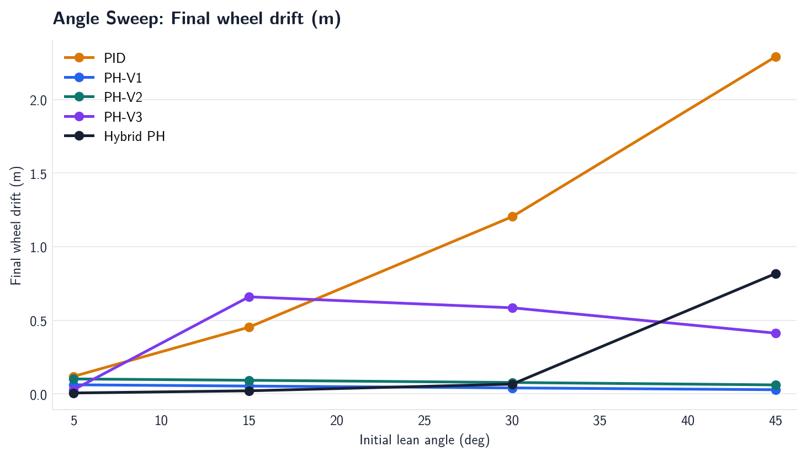
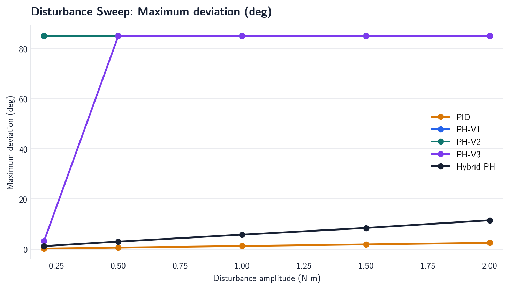
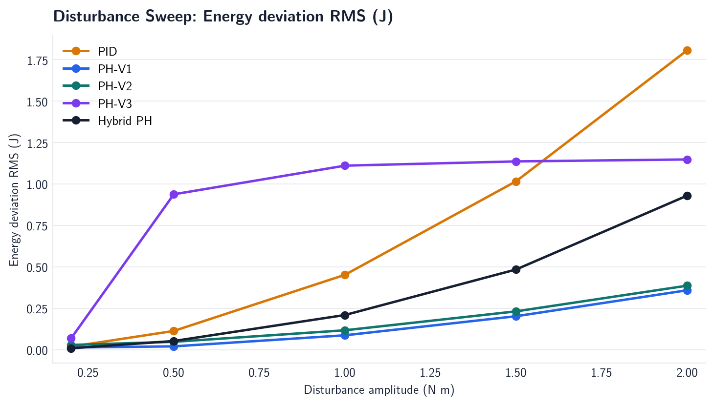
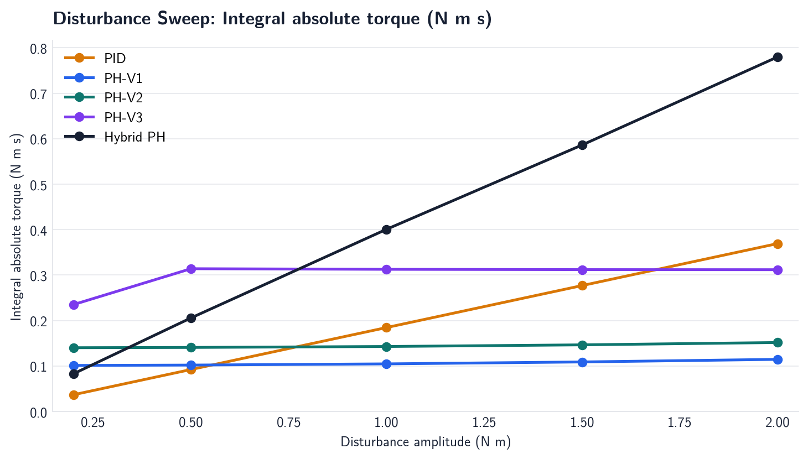

# PH-Balance Phase 3 Final Analysis

## Scope and evidence

This report compares PID, PH-V1, PH-V2, PH-V3, and Hybrid PH using the
official Phase 3 data in `metrics.csv` and `robustness_summary.csv`.

The matrix contains 12 deterministic simulations per controller:

- main cases: 15 degree stabilization, a 1 N m body-torque pulse, and
  parameter uncertainty (body mass +25%, friction x2);
- initial-angle sweep: 5, 15, 30, and 45 degrees;
- disturbance sweep: 0.2, 0.5, 1.0, 1.5, and 2.0 N m pulses.

All controllers use the same plant, 0.02 s sample/hold interval, 3 N m torque
limit, and 85 degree termination limit. A run is successful only when it
finishes without termination and remains within the 2 degree settling band.
The runs are deterministic single trials; this is evidence about this model
and gain set, not a statistical robustness claim.

## 1. Does Hybrid PH improve robustness?

Yes relative to the previous PH versions in this test matrix, but not enough
to call it globally robust.

| Controller | Main | Angle sweep | Disturbance sweep | All 12 cases | Angle-limit fallovers |
| --- | ---: | ---: | ---: | ---: | ---: |
| PID | 3/3 | 4/4 | 5/5 | 12/12 | 0 |
| PH-V1 | 0/3 | 0/4 | 0/5 | 0/12 | 12 |
| PH-V2 | 0/3 | 0/4 | 0/5 | 0/12 | 12 |
| PH-V3 | 1/3 | 1/4 | 1/5 | 3/12 | 8 |
| Hybrid PH | 3/3 | 2/4 | 5/5 | 10/12 | 0 |

The improvement is strongest in the disturbance and uncertainty cases:

- Hybrid PH completed all five disturbance amplitudes, while PH-V3 completed
  only the 0.2 N m case.
- Hybrid PH completed the nominal, disturbance, and parameter-uncertainty
  main cases. PH-V3 fell over in the latter two.
- The 30 and 45 degree Hybrid PH angle cases did not settle within the 4 s
  horizon. They did not hit the angle-limit event, but they still count as
  failures under the stated success definition.

Therefore the defensible claim is **substantial improvement over PH-V1/V2/V3
for the tested scenarios**, not broad or global robustness.

### Robustness progression in the disturbance sweep

Hybrid PH remained successful at 0.2, 0.5, 1.0, 1.5, and 2.0 N m. Its
performance degraded monotonically with pulse size:

| Pulse | RMSE (deg) | Recovery (s) | Wheel drift (m) | ZOH effort (N m s) |
| ---: | ---: | ---: | ---: | ---: |
| 0.2 N m | 0.418 | 0.000 | 0.021 | 0.083 |
| 0.5 N m | 1.043 | 1.400 | 0.054 | 0.206 |
| 1.0 N m | 2.079 | 1.980 | 0.122 | 0.401 |
| 1.5 N m | 3.131 | 2.340 | 0.223 | 0.586 |
| 2.0 N m | 4.304 | 2.740 | 0.403 | 0.780 |

This is disturbance tolerance with increasing performance cost, not
disturbance invariance.

## 2. Is the Port-Hamiltonian interpretation preserved?

It is preserved as a hybrid control architecture, with an important
qualification.

The implemented Hybrid PH law is

\[
u = -K_e(H_c-H_d)y - K_d y - Kx,
\]

where

\[
y = \dot{s}/r - \dot{\theta},
\qquad
x = [\theta,\dot{\theta},s,\dot{s}]^T.
\]

The first two terms retain the PH-inspired structure:

- `H_c` is the upright-relative control Hamiltonian;
- the energy term regulates the energy error through the actuator power port;
- `-K_d y` injects damping at that same port.

The final term, `-Kx`, is a local full-state stabilizer. It regulates the
lean and wheel modes that the scalar energy law cannot distinguish. This is
why the controller can be described as a **Hybrid Port-Hamiltonian
controller**.

However, the result is not a complete pure PH or IDA-PBC proof. The state
feedback was selected from a local linear stabilization design and is not
itself derived from a formally shaped closed-loop `J-R` structure. The
single torque saturation is also a nonsmooth actuator constraint. In
addition, the controller uses the upright-relative shaped Hamiltonian while
the plant dynamics use the physical gravitational Hamiltonian. These choices
are valid engineering design choices, but they limit the claim to a
PH-inspired local hybrid law rather than a global passivity or Lyapunov
theorem.

## 3. Comparison against PID

PID is the most reliable controller in the tested matrix: it succeeds in
12/12 cases, compared with 10/12 for Hybrid PH. Thus Hybrid PH does not
outperform PID on the primary binary success criterion.

The continuous metrics show a trade-off rather than a universal winner:

| Main case | Controller | RMSE (deg) | Settling (s) | Wheel drift (m) | ZOH effort (N m s) |
| --- | --- | ---: | ---: | ---: | ---: |
| 15 degree stabilization | PID | 2.250 | 0.220 | 0.453 | 0.402 |
| 15 degree stabilization | Hybrid PH | 3.164 | 1.680 | 0.021 | 0.297 |
| 1.0 N m disturbance | PID | 0.177 | 0.000 | 0.916 | 0.185 |
| 1.0 N m disturbance | Hybrid PH | 2.079 | 6.980 | 0.122 | 0.401 |
| parameter uncertainty | PID | 2.260 | 0.220 | 0.522 | 0.396 |
| parameter uncertainty | Hybrid PH | 3.235 | 1.640 | 0.015 | 0.327 |

For the three main cases, Hybrid PH consistently produces much less final
wheel drift. PID consistently gives smaller angle error and faster settling.
Effort depends on the scenario: Hybrid PH is lower in the nominal and
uncertainty cases, but higher for the 1.0 N m disturbance.

In the disturbance sweep both controllers complete all five cases. PID has
lower angle RMSE, shorter recovery, and lower effort; Hybrid PH has lower
final wheel drift. In the angle sweep PID completes all four cases, while
Hybrid PH completes only the 5 and 15 degree cases. The successful-run mean
for Hybrid PH in that sweep must not be compared as if it included the failed
30 and 45 degree cases.

The data therefore support this narrower comparison:

- PID is the stronger practical baseline for fast angle recovery and overall
  success rate.
- Hybrid PH provides substantially better wheel-position regulation in these
  runs and retains an interpretable energy/port-damping component.
- Neither controller dominates every continuous metric.

## 4. Controller evolution

| Version | Added structure | Observed result |
| --- | --- | --- |
| PH-V1 | Scalar energy shaping and actuator-port damping | 0/12 successes; energy alone did not select the restoring lean direction. |
| PH-V2 | Directional angle shaping | 0/12 successes; the wheel mode remained insufficiently regulated. |
| PH-V3 | Angle shaping plus wheel-position and velocity feedback | 3/12 successes; nominal local stabilization recovered, but disturbance and uncertainty failures remained. |
| Hybrid PH | PH energy/damping terms plus full-state local stabilizer | 10/12 successes; no angle-limit fallovers, but high-angle cases did not settle. |

The data support the conclusion that Hybrid PH addresses the dominant PH-V3
weakness more effectively than the earlier PH revisions: it removes the
fallovers in the tested disturbance and uncertainty cases and reduces wheel
drift. It does not eliminate the limited region of attraction.

## 5. Plots and source data

The report reuses the official Phase 3 plots generated from the same CSV
measurements:

Primary data files: [metrics.csv](metrics.csv),
[robustness_summary.csv](robustness_summary.csv), and the per-scenario
trajectory CSV files in this directory.

## 6. Remaining limitations

1. **Limited region of attraction.** Hybrid PH does not meet the settling
   criterion at 30 or 45 degrees within the tested horizon.
2. **No formal global stability result.** The local state feedback improves
   the linearized behavior, but the nonlinear closed loop with saturation has
   not been proven globally stable.
3. **Small uncertainty study.** Only one mass/friction perturbation was
   tested. Inertia, wheel radius, gravity, actuator dynamics, delay, and
   nonlinear friction were not varied.
4. **Ideal sensing and actuation.** The simulation uses direct state feedback
   and omits sensor noise, delay, sampling jitter, motor electrical dynamics,
   voltage limits, and wheel slip.
5. **Single deterministic trials.** Positive initial angles and deterministic
   pulses were used. Negative lean, randomized disturbances, and repeated
   trials are not represented.
6. **Metric scope.** `wheel_drift_m` is absolute final wheel position, not
   maximum excursion or total wheel travel. A controller can move farther
   temporarily and return near zero without that excursion appearing in this
   metric.
7. **Finite-horizon classification.** The two high-angle Hybrid PH runs were
   bounded for the 4 s simulation but not settled. Longer horizons could
   change their classification, but that would be a new experiment rather
   than evidence from the current matrix.

## Final verdict

Hybrid PH is a meaningful Phase 3 improvement over PH-V1, PH-V2, and PH-V3
within the tested simulation matrix. It preserves a visible energy-shaping
and port-damping interpretation while adding the local state feedback needed
to regulate the wheel mode. It does not outperform PID overall: PID achieved
12/12 successes, while Hybrid PH achieved 10/12 and was slower and less
accurate in angle recovery. The strongest evidence in favor of Hybrid PH is
its zero-fallover result, improved disturbance/uncertainty completion, and
lower wheel drift. The strongest evidence against a broader claim is its
failure to settle from 30 and 45 degrees and the absence of a formal global
stability proof.

The appropriate portfolio claim is:

> Hybrid PH substantially improves the robustness and wheel-mode regulation
> of the earlier PH controllers in simulation, while retaining an explicit
> energy/port-damping structure; however, PID remains the more reliable
> controller across the complete tested scenario matrix, and Hybrid PH should
> be presented as a locally stabilizing research prototype rather than a
> globally robust replacement.
