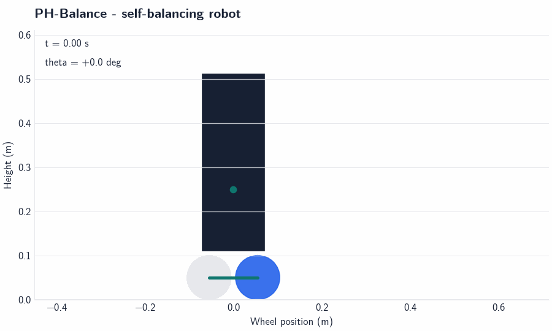

# PH-Balance Demo Showcase

This is the short visual path through the project. It is designed to answer
three questions quickly: does the robot balance, does it recover from a
disturbance, and how do the controllers compare?

## 1. Balancing behavior

The Hybrid PH controller starts from a 15 degree lean and returns the body
toward upright while regulating final wheel position.


## 2. Disturbance recovery

At 5 seconds, the simulation applies a 1.0 N m body-torque pulse. The
animation shows the robot response and wheel motion after the disturbance.



## 3. Controller comparison

The comparison uses the same plant and simulation conditions for PID, PH-V1,
PH-V2, PH-V3, and Hybrid PH. Terminated trajectories stop early instead of
being hidden from the plot.


## Portfolio takeaway

PID is the most reliable controller in the tested matrix. Hybrid PH improves
the earlier PH variants, reduces wheel drift, and completes the disturbance
sweep, but it does not settle from every initial angle. The visuals show both
the engineering improvement and the remaining trade-off.

Regenerate the animations with:

```bash
python -m experiments.build_demo_assets
```
